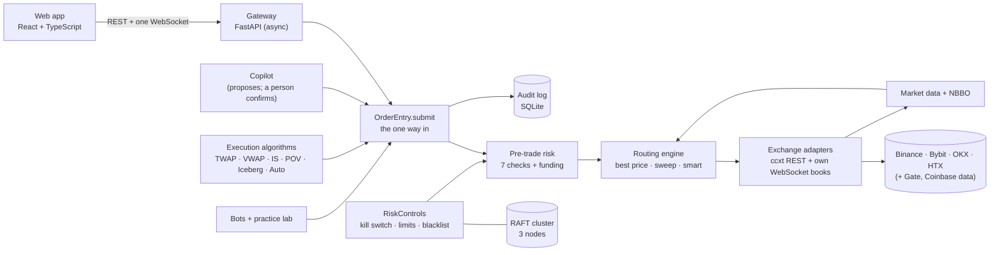

# ApnaSOR — Smart Order Router for Crypto Exchanges

[](https://github.com/SarmadSufyan/Smart-Order-Routing-ApnaExchange/actions/workflows/ci.yml)

**One order, every exchange, the best price — with risk controls a person can trust.**

ApnaSOR is the smart order router (SOR) of *Apna Exchange*. It keeps live order books from real crypto exchanges,
finds the best price across all of them after fees, checks every order against deterministic pre-trade risk rules,
and splits it into price-protected orders on several exchanges at once. Large orders can be worked over time by
execution algorithms; a copilot answers questions and proposes trades in plain English; every step is written to an
append-only audit log.

Final Year Project · Usman Institute of Technology (UITU) · Group CS14 · Supervisor: **Sir Shamaail Jafri**

| Team | Roll no. |
|---|---|
| Sarmad Sufyan Ahmed (lead, backend) | 23SP-078-CS |
| Fizza Mubeen | 23SP-070-CS |
| Mahnoor Nadeem | 23SP-065-CS |
| Maham Ikram | 23SP-101-CS |

---

## Contents

[What it does](#what-it-does) · [Architecture](#architecture) · [Exchanges](#exchanges) · [Run it](#run-it-locally) ·
[Quality](#tests-and-quality) · [Deployments](#deployments) · [Documentation](#documentation) ·
[For evaluators](#a-15-minute-tour-for-evaluators) · [Scope and honest limits](#scope-and-honest-limits) ·
[Repository layout](#repository-layout)

---

## What it does

| Area | In one line |
|---|---|
| **Market data** | Local order books kept in sync from each exchange's WebSocket feed (sequence-checked, resynced on a gap); a consolidated best bid / best offer (NBBO) across exchanges |
| **Smart order routing** | Three strategies: **best price after fees** (walks every book, cheapest all-in levels first), **liquidity sweep** (every exchange at once in proportion to depth under one price cap) and **smart** (best price weighted by each exchange's measured fill reliability) |
| **Execution** | Every child order is **IOC LIMIT, price-protected**; a refused part is re-routed to the remaining exchanges; network errors are reconciled by client order id |
| **Pre-trade risk** | Seven deterministic checks in one pure function (kill switch, size, notional, rate, position, exposure, symbol) plus a funding check that each exchange can pay for its part |
| **Risk monitor** | Watches the whole book every 2 s: a trading-loss limit engages the kill switch automatically; concentration alerts |
| **Kill switch, limits, blacklist** | Persisted across restarts; optionally replicated by a 3-node **RAFT** cluster (signed messages; tightening works without a majority, loosening needs one) |
| **Execution algorithms** | **TWAP, VWAP, implementation shortfall (Almgren–Chriss), POV, iceberg** — or **Auto** chooses one and explains why. Every slice goes through the same order path and risk checks |
| **Wallet and P&L** | Balances read from each exchange, a P&L ledger from opening balances plus every fill, and reconciliation against what each exchange reports |
| **Research** (read-only) | Five years of hourly and ~8 years of daily real-market candles: indicators, next-minute / hour / day forecasts with a walk-forward track record, fee-aware backtests, a study of classic trading techniques against buy-and-hold, trade plans |
| **Copilot** | Plain-English questions and instructions. A language model only fills a strict form; code validates it, gathers the facts (an analyst of pure rules on the research) and builds the proposal. **A person confirms every action** |
| **Bots and practice lab** | A profit-cycle bot and an advisor agent trading from a separate automation fund; a practice lab records every bot trade (measured costs, a variant scoreboard, outcome models) |
| **Arbitrage detector** | Scans every exchange pair four times a second and measures cross-exchange gaps after both taker fees. **Detection only** — it cannot trade |
| **Audit log** | Append-only record of every order step, risk decision, routing decision, fill and operator action, with who did it |
| **Real money (Phase D)** | The same code path behind extra rails: an exchange receives orders only after it confirms our key **can trade but cannot withdraw** and is locked to the server's IP; hard caps no screen can loosen |

## Architecture



Design rules the code keeps (and the tests check):

1. **One way in.** Every order — the order button, an algorithm slice, a bot, a confirmed copilot proposal — goes
   through `OrderEntry.submit` and meets the same risk checks.
2. **Children are IOC LIMIT, price-protected.** No resting orders; a market order is capped at the worst planned
   price plus a protection margin.
3. **Reality wins.** A fill reported by an exchange is always recorded; mismatches are shown by reconciliation,
   never edited away.
4. **Fail-safe state.** An engaged kill switch stays engaged after a restart; running algorithms come back paused.
5. **Never interrupt a call at the exchange.** Pause and cancel take effect between steps.
6. **No secrets in code.** Keys, signing secrets and password hashes live in `.env` / `data/` per machine.

## Exchanges

| | Exchange | Market data | Orders in the sandbox | Real money |
|---|---|---|---|---|
| V1 | **Binance** | live public feed | spot testnet | ✔ |
| V4 | **Bybit** | live public feed | demo trading | ✔ |
| V5 | **OKX** | live public feed | demo trading | ✔ |
| V7 | **HTX** | live public feed (gzip snapshots) | — (no sandbox: data only) | ✔ |
| V6 | Gate | live public feed | spot testnet | — (Pakistan is a restricted location in its terms) |
| V2 | Coinbase | live public feed (optional) | — (data only) | — |

Trading universe: **BTC, ETH, SOL, BNB, XRP against USDT**, decimal quantities. Decisions always use the **real
market's** order books; *where* orders execute (sandbox or real funds) is a separate setting.

## Run it locally

Requirements: Python 3.11+ (developed on 3.14), Node.js 18+ (developed on 24), Git.

```powershell
pip install -r backend/requirements.txt          # + backend/requirements-dev.txt for the tests
cd frontend; npm install; cd ..
Copy-Item .env.example .env                       # add your own testnet / demo keys (project-info/API_KEYS_GUIDE.md)
python scripts/check_exchange_keys.py            # which exchanges your keys reach, with sandbox balances
python start_all.py                              # RAFT nodes (if enabled) -> gateway :8000 -> web app :5173
```

| Service | Address |
|---|---|
| Web app | http://localhost:5173 — on a developer machine the demo login works (`admin` / `admin`); real passwords: [`SECURITY_GUIDE.md`](project-info/SECURITY_GUIDE.md) |
| API + Swagger | http://127.0.0.1:8000/docs |

Without exchange keys the system still shows live market data; trading needs sandbox keys. To run the RAFT cluster,
set `RAFT_ENABLED=true` and your own `RAFT_SHARED_SECRET` in `.env`
([`PHASE6_GUIDE.md`](project-info/PHASE6_GUIDE.md)). Starting and stopping: [`START_STOP_GUIDE.md`](project-info/START_STOP_GUIDE.md).

## Tests and quality

```powershell
python -m unittest discover -s backend/tests -t .   # 592 backend tests
npx --prefix frontend tsc --noEmit -p frontend      # strict TypeScript type-check
python -m ruff check backend scripts start_all.py   # lint
```

- **Continuous integration** ([`.github/workflows/ci.yml`](.github/workflows/ci.yml)): the backend tests on clean
  **Linux and Windows** machines, the lint and the type-check, on every push and pull request.
- **Server kits** ([`lab-server-kit.yml`](.github/workflows/lab-server-kit.yml),
  [`real-server-kit.yml`](.github/workflows/real-server-kit.yml)): each deployment kit is installed on a fresh
  Ubuntu 24.04 machine and exercised there: crash and hang recovery, backups, a second release and the
  rollback; for the real-money kit also the hidden key prompt, go-live with its safety check, and the promotion
  gate refusing an untested release.
- **Pure logic is tested directly**: risk checks, routing strategies, algorithm schedules, P&L maths, RAFT (no I/O,
  no clock), the forecast models and the copilot's validation.
- **Verified on the real exchanges**, not only in tests: every exchange quirk the system handles (price-limit bands,
  fees charged in coins, lagging order history, lot rounding, exchange minimums) was found live with small orders.

## Deployments

| Where | What runs | Guide |
|---|---|---|
| Developer laptop | The full system against the exchanges' sandboxes | this README, [`START_STOP_GUIDE.md`](project-info/START_STOP_GUIDE.md) |
| **Lab server** (AWS, Zurich, 24/7) | The bots and the practice lab on sandbox funds, measuring costs and outcomes around the clock | [`LAB_SERVER_GUIDE.md`](project-info/LAB_SERVER_GUIDE.md) |
| **Real-money server** (AWS, Zurich, fixed IP) | The same code with real keys: trade-only, withdrawals off, IP-locked, hard caps in its settings; reached only through an SSH tunnel | [`REAL_MONEY_GUIDE.md`](project-info/REAL_MONEY_GUIDE.md), [`PHASE_D_PLAN.md`](project-info/PHASE_D_PLAN.md) |

Each server installs one tested commit as a release (tests run on the server first, databases backed up, automatic
rollback if it isn't healthy). Once the real-money server is live, a new release reaches it only after the same
commit has run for 72 hours on the lab server with CI green (the promotion gate).

## Documentation

| Guide | What it explains |
|---|---|
| [`ALGORITHMS_GUIDE.md`](project-info/ALGORITHMS_GUIDE.md) | Every routing strategy and execution algorithm: the idea, the maths, live results, Q&A |
| [`RESEARCH_GUIDE.md`](project-info/RESEARCH_GUIDE.md) | Forecasts, indicators, backtests, the technique study, trade plans — and how well they work |
| [`COPILOT_GUIDE.md`](project-info/COPILOT_GUIDE.md) | The copilot and its analyst: how it decides, what the language model may and may not do, safety |
| [`AUTOMATION_GUIDE.md`](project-info/AUTOMATION_GUIDE.md) | The automation fund, profit-cycle bot, advisor agent and practice lab |
| [`PHASE6_GUIDE.md`](project-info/PHASE6_GUIDE.md) | Risk batch pre-flight, the Monte Carlo stress test and the RAFT cluster |
| [`SECURITY_GUIDE.md`](project-info/SECURITY_GUIDE.md) · [`EXCHANGE_API_KEY_SECURITY.md`](project-info/EXCHANGE_API_KEY_SECURITY.md) | Logins, signing keys, CORS, and how exchange keys are protected |
| [`REAL_MONEY_GUIDE.md`](project-info/REAL_MONEY_GUIDE.md) · [`PHASE_D_PLAN.md`](project-info/PHASE_D_PLAN.md) | The real-money rails, the separate server, the stages and decisions |
| [`API_KEYS_GUIDE.md`](project-info/API_KEYS_GUIDE.md) | Which sandbox keys you need and how to get them |
| [`ROADMAP.md`](project-info/ROADMAP.md) · [`PROGRESS.md`](PROGRESS.md) | What is done, what is next, and the current state |
| [`DEVELOPMENT_JOURNAL.md`](DEVELOPMENT_JOURNAL.md) | Every change, dated: what, why, and the design choices |
| [`CONTRIBUTING.md`](CONTRIBUTING.md) · [`ONBOARDING.md`](ONBOARDING.md) | Team workflow and first-time setup |

The live API contract is the gateway's Swagger page. The documents in `project-info/` marked **historical** describe
the June 2026 simulated-venue prototype and are kept for the record ([index](project-info/README.md)).

## A 15-minute tour for evaluators

1. **The order path** — `backend/services/order_state/entry.py` (`OrderEntry.submit`, the one way in) →
   `backend/services/risk_engine/checks.py` (the seven checks, one pure function) →
   `backend/services/routing_engine/engine.py` and `strategies/` (best price, sweep, smart).
2. **The exchanges** — `backend/exchanges/ccxt_venue.py` (IOC children, idempotent client ids, reconciliation) and
   one adapter, e.g. `backend/exchanges/binance/`; `key_permissions.py` for the real-money key check.
3. **Execution algorithms** — `backend/services/algos/schedules.py` (the pure maths: VWAP profile, Almgren–Chriss,
   POV, iceberg, Auto's choice) and `engine.py`; explained in [`ALGORITHMS_GUIDE.md`](project-info/ALGORITHMS_GUIDE.md).
4. **Safety** — `backend/services/risk_engine/` (kill switch, risk monitor, real-money caps in `ceilings.py`) and
   `backend/services/consensus/` (RAFT: `core.py` is the algorithm with no I/O).
5. **The copilot** — `backend/services/agents/copilot.py`: the model fills a form, code validates every field,
   a person confirms.
6. **Tests** — `backend/tests/` (592), and the CI runs on this branch.
7. **The history** — [`DEVELOPMENT_JOURNAL.md`](DEVELOPMENT_JOURNAL.md): why each decision was made.

## Scope and honest limits

- **Sandbox means exchange-run fake funds.** Binance's testnet, Bybit's and OKX's demo trading are the exchanges' own
  systems with play money; HTX has no sandbox, so there it supplies market data only.
- **Not non-custodial.** The exchanges hold the funds; ApnaSOR reads balances and places orders with API keys.
- **The arbitrage module detects; it does not trade.** After both taker fees, real cross-exchange gaps are rare.
- **Forecasts are probabilities with a measured track record, not predictions.** Most show no proven edge after
  fees, and the system says so. Nothing in the research or the copilot is financial advice.
- **The contribution is the integration** — real-time books from several exchanges, fee-aware routing, deterministic
  risk, execution algorithms and their audit trail working as one system — not a new trading algorithm.

## Repository layout

| Path | Contents |
|---|---|
| `backend/exchanges/` | Exchange adapters: shared execution core, order books, precision, key checks, fees |
| `backend/gateway/` | FastAPI app: settings, logins, routers, the WebSocket |
| `backend/services/` | Order entry and state, routing, risk, market data, wallet and P&L, algorithms, research, automation, copilot, arbitrage, RAFT, audit, alerts |
| `backend/shared/` | Data models (Pydantic v2), the audit store, the event bus, logging |
| `backend/tests/` | The unit and integration tests |
| `frontend/src/` | The web app: pages, components, the API client, the data store, three themes |
| `deploy/lab-server/`, `deploy/real-server/` | The two server kits: setup, release with rollback, status, backups, systemd units |
| `scripts/` | Exchange key checks, security check, RAFT demo, benchmarks, exports, backups |
| `project-info/` | The guides above, plus historical design documents |
| `start_all.py` | Starts the RAFT nodes, the gateway and the web app in order; stops them cleanly |
| `venues/`, `tests/`, `infra/`, `diagrams/` | Historical: the June 2026 simulated-venue prototype and its M1 diagrams (not used by the running system) |
